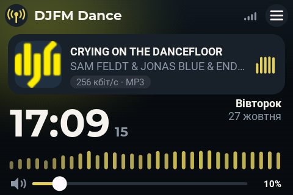
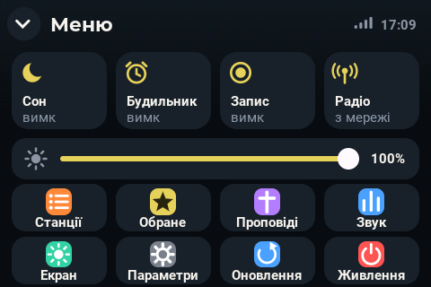
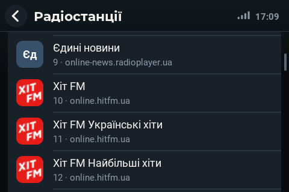
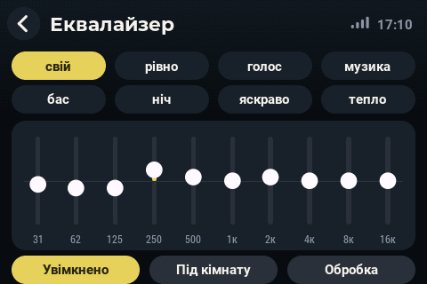
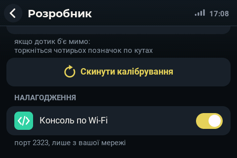

# POTUZHNE RADIO — ES3C35P board (3.5″)

[Українська](README.md) · **English**

> The other board — **[POTUZHNE RADIO for ES3C28P (2.8″)](https://github.com/roman885-85/potuzhne-radio)**: the main
> project this radio was ported from. Its README describes every screen, the radio's web page and the apps in detail
> (in Ukrainian).

An internet radio on the **LCDwiki ES3C35P** board: ESP32-S3 (16 MB flash, 8 MB PSRAM), a **3.5″ IPS 320×480**
display on the ST77922 controller (QSPI) with a **built-in touch panel**, ES8311 codec with a microphone and an
SC8002B amplifier, microSD slot (SDIO), WS2812 LED. The radio runs in **480×320 landscape** (USB connector on the
right).

It is the same POTUZHNE RADIO as on ES3C28P — internet radio stations, music from the memory card, sermons from the
church website, alarm clock, on-air recording, AirPlay and DLNA wireless speaker, a web page in the browser and
apps for Android, Windows and Mac — moved to a bigger screen and a new controller. To keep working on it without
a cable, the radio has a **Wi-Fi debug console**: commands, log, screenshots and firmware updates over the network.

<p>


</p>
<p>


</p>

> **Status:** version **1.0** — being verified on the board. There are no releases for this board yet: they will
> appear here once everything is verified, and then the radio will update itself. Until then — flash a build from
> source (see "Building").

The radio's own interface is in Ukrainian or English (Menu › Settings › Language).

---

## Contents

- [Features](#features)
- [Differences from ES3C28P](#differences-from-es3c28p)
- [Board and pins](#board-and-pins) · [External DAC PCM5100/PCM5102A](#external-dac-pcm5100pcm5102a)
- [Installation](#installation)
- [Working without USB: console, screenshots and flashing over Wi-Fi](#working-without-usb-console-screenshots-and-flashing-over-wi-fi)
- [Building from source](#building-from-source)
- [Repository layout](#repository-layout)
- [License and credits](#license-and-credits)

---

## Features

- **Internet radio stations** — MP3, AAC, FLAC, WAV; smooth switching, song titles, station logos. The radio finds
  logos by itself — in the radio-browser catalog, on the station's website, via Google's favicon service — and
  checks each one for readability in its 45×45 cell: a tiny caption or a white mark on white is rejected and the
  search goes on.
- **Memory card** — music and on-air recordings; Behringer X-LIVE mixer recordings (WAV up to 32 channels × 32 bit)
  play mixed down.
- **Sermons** from the church website — archive, covers, seeking, back to the station.
- **Alarm clock** (wakes even a switched-off radio) and a **sleep timer** with a gentle fade-out; **daylight saving
  time** switches automatically.
- **On-air recording** to the card.
- **Sound:** 10-band equalizer with presets, speaker protection, virtual bass, loudness compensation, balance, room
  correction measured with the built-in microphone.
- **Microphone:** claps and knocks on the case as commands, room presence.
- **Wireless speaker:** AirPlay (iPhone, iPad, Mac) and DLNA.
- **Radio web page** (`http://potuzhne-xxxx.local/`) and apps for Android, Windows, Mac — the same as for ES3C28P.
- **Interface** with smooth animations: pages slide in, lists scroll with inertia, the volume slider glides. A frame
  is composed in PSRAM and sent to the panel whole, synchronized to the panel's tearing-effect signal (TE) — no
  tearing.
- **Screen languages:** Ukrainian and English.
- **Wi-Fi debug console** — see [below](#working-without-usb-console-screenshots-and-flashing-over-wi-fi).

Every screen and the web page are described in detail in the main project's README (Ukrainian):
[github.com/roman885-85/potuzhne-radio](https://github.com/roman885-85/potuzhne-radio#екран-радіо).

---

## Differences from ES3C28P

| | ES3C28P | **ES3C35P** |
|---|---|---|
| Display | 2.8″ 240×320, ILI9341V (SPI) | **3.5″ 320×480, ST77922 (QSPI, 80 MHz)**; the radio runs in 480×320 landscape |
| Rotation | in hardware | the panel cannot rotate in QSPI mode — the radio rotates the frame itself (ESP32-S3 vector instructions) |
| Touch | FT6336 | **built into the ST77922** (I2C 0x55) |
| Amplifier | FM8002E | SC8002B (enabled by GPIO1 low) |
| Interface | 320×240 | the same, scaled ×4/3: fonts, buttons, spacing |
| External DAC | on spare pins | on the board's own P2/P3 connectors, no soldering (see below) |
| Releases | [potuzhne-radio](https://github.com/roman885-85/potuzhne-radio/releases) | this repository (none yet) |

Both boards build from the same source tree (`source/yoRadio/myoptions.h`); `firmware/rebuild.sh` selects which.

---

## Board and pins

ESP32-S3 N16R8: 16 MB QSPI flash, 8 MB OPI PSRAM; USB-CDC goes straight into the ESP32-S3, no USB-UART chip.

| Part | Pins |
|---|---|
| ST77922 display, QSPI | SCK 12, D0 11, D1 13, D2 14, D3 9, CS 10, TE 42; backlight 41 (PWM) |
| Touch (inside ST77922) | I2C SDA 38, SCL 39, address 0x55; INT 47, RST 48 |
| ES8311 codec | I2C 38/39 (0x18); I2S MCLK 17, BCLK 18, LRCK 21, DOUT 15, DIN 16 (microphone) |
| SC8002B amplifier | enable — GPIO1 low |
| microSD | 4-bit SDIO: CLK 5, CMD 4, D0 6, D1 7, D2 2, D3 3 |
| WS2812 LED | 40 |
| Battery voltage | 8 (100 K / 100 K divider) |
| External amplifier MUTE | RXD0 (IO44), connector P2, pin 4 |

Buttons are not used by the radio — touch only; BOOT is needed for flashing only.
Manufacturer's board page: <https://www.lcdwiki.com/3.5inch_ESP32-S3_Display>.

### External DAC PCM5100/PCM5102A

For a line output to an amplifier or headphones — a PCM5100/PCM5102A module on the board's own connectors
(4-pin, 1.25 mm pitch), no soldering:

| Module | Board |
|---|---|
| BCK | P3, pin 4 — IO45 |
| LCK | P3, pin 3 — IO46 |
| DIN | P2, pin 3 — TXD0 (IO43) |
| VIN | P2, pin 1 — +5 V |
| GND | P2 or P3, pin 2 |
| SCK | to GND (the module makes its own clock) |
| XSMT | to 3.3 V (P3, pin 1) |

Then on screen: **Menu › Settings › Developer › Audio output** — "stereo DAC, line output".

### External amplifier MUTE

The radio mutes an external amplifier (or the DAC via its XSMT input) while it is silent: at power-on, after stop, in
sleep, before a restart or update; it unmutes only while a station, an event sound or a test tone is playing and the
sound goes to the external DAC. Switching stations does not mute it — so it does not click. The pin is **RXD0 (IO44), connector P2, pin 4**. Setting:
**Menu › Settings › Developer › Amplifier MUTE (RXD0)** (also on the radio's web page: Developer):

| Mode | Quiet when | For | Resistor to stay quiet at power-on |
|---|---|---|---|
| off | — | pin unused | — |
| quiet when low | low level | XSMT on PCM5102A, MUTE on PAM8403 | 10 kΩ from RXD0 to GND |
| quiet when high | high level | MUTE on TPA3116 | 10 kΩ from RXD0 to 3.3 V |

Until the firmware starts, nothing drives RXD0 (it is a UART input) — the resistor keeps it quiet at power-on. Below
the switch you see the pin's current state: "sound" or "quiet". For PCM5102A in "quiet when low" mode XSMT goes to
RXD0 (not to 3.3 V) — the wiring diagram on screen and on the web page shows it that way.

---

## Installation

### 1. Flash (by cable, the first time)

There are no ready-made files for this board yet — [build](#building-from-source) first, then from `firmware`:

```bash
./flash.sh                 # full image: erases stations, networks and settings
./flash.sh --app-only      # program only: stations, networks and settings stay
```

The board enters download mode by itself. After writing it stays in the bootloader — `flash.sh` restarts it via
the RTS line with DTR kept low (on this board a raised DTR holds GPIO0 low and sends it back to the bootloader).

### 2. Connect to Wi-Fi

While there is no network, the radio shows a list of networks: pick yours and type the password on the on-screen
keyboard. 2.4 GHz networks only; the radio remembers up to five.

### 3. Use it

By touch, from the radio's web page (`http://potuzhne-xxxx.local/`; the address is also on the "About" screen) or
with the apps — they find the radio on the network by themselves.

---

## Working without USB: console, screenshots and flashing over Wi-Fi

Everything the radio writes to its console (the `##…` log and debug command replies) also goes to the network — to
**TCP port 2323**. A connected client sees the log live and sends the same commands as over USB. A cable is only
needed for the very first flashing.

- **On by default.** The switch is **Menu › Settings › Developer › DEBUGGING › Wi-Fi console**; below it you see
  who is connected.

  

- **Local network only:** the radio accepts connections only from its own subnet.
- **Log in memory:** the radio keeps the last 64 KB of output in PSRAM (including the boot log, which could not be
  heard over the network yet); the channel command `hist` replays it, `bye` disconnects.
- The radio's tasks never wait for the network: a slow client just misses part of the log (with a marker).

**Radio address** — its network name `potuzhne-xxxx.local` (shown on the radio's web page) or IP. The tools take it
from `--net ADDRESS`, the `RADIO_HOST` variable or the file `tools/es3c35p/.radio` (first line; not in git):

```bash
echo potuzhne-xxxx.local > tools/es3c35p/.radio
```

With no USB port but a known address, the tools go over Wi-Fi by themselves.

| What | Command |
|---|---|
| Commands and replies | `tools/es3c35p/con.py --net info heap` |
| Listen to the log | `tools/es3c35p/con.py --net --listen 60` |
| Log from the radio's memory | `tools/es3c35p/con.py --net hist` |
| Restart and see the boot log | `tools/es3c35p/con.py --net --reset --listen 20` |
| Screenshot to PNG | `tools/es3c35p/scr.py --net shot.png` |
| Flash without a cable | `firmware/flash.sh --wifi` (or `--wifi ADDRESS`) |
| Any TCP client | `nc potuzhne-xxxx.local 2323` |

**Flashing over Wi-Fi:** `flash.sh --wifi` checks that the file was built for ES3C35P, sends it to `/update`, waits
for the restart and checks that the new build answers. The radio also checks the board marker inside the image
(`POTUZHNE-RADIO-FW|ES3C35P|…`) itself and refuses firmware for another board — without a cable there would be
nothing to fix it with.

**Useful console commands** (full list — `source/yoRadio/src/menu/yoDebug.cpp`):

| Command | What it does |
|---|---|
| `info`, `heap`, `net` | state: mode, station, volume; memory; network |
| `play N`, `vol N`, `stop` | play station N, volume (0…254), stop |
| `aunet`, `audiostat` | per-second stream report; audio dropouts over a period |
| `logost`, `logoqual`, `logoall` | logos: search state, readability, find for all stations |
| `scr` | screenshot (decoded by `scr.py`) |
| `netcon` | Wi-Fi console state: client, bytes sent, skipped |
| `netfreeze N` | freeze the station connection — tests how fast the radio reconnects |
| `reboot` | restart |

Console messages and command replies are in Ukrainian (the project's working language).

---

## Building from source

On a Mac (on Linux — the same, except `flash.sh`, which uses macOS ports):

1. [arduino-cli](https://arduino.github.io/arduino-cli/) and the ESP32 core **3.3.3**:
   ```bash
   arduino-cli core update-index --additional-urls https://espressif.github.io/arduino-esp32/package_esp32_index.json
   arduino-cli core install esp32:esp32@3.3.3 --additional-urls https://espressif.github.io/arduino-esp32/package_esp32_index.json
   ```
2. Build for ES3C35P (the version number is in `firmware/VERSION`):
   ```bash
   cd firmware && ./rebuild.sh ES3C35P
   ```
   The first build takes about 13 minutes, later ones a few. Libraries are in `build/sketchbook/libraries/`.
3. Results are in `firmware/`: `PotuzhneRadio-ES3C35P-update.bin` (program), `-full.bin` (full image), `web/`
   (the radio's web page files).
4. Flash: `./flash.sh --app-only` (cable) or `./flash.sh --wifi` (network).

`rebuild.sh` wraps `dns_clear_cache` (`-Wl,--wrap`): in Arduino core 3.3.3 the first DNS query after an address
change cleared the DNS cache without holding the lwIP lock, and the radio crashed (`Required to lock TCPIP core`).

Publishing a release the radios update from: `tools/release.sh <version> <notes>` (`--beta` — pre-release).

---

## Repository layout

| Folder | Contents |
|---|---|
| `source/yoRadio/myoptions.h` | both boards: pins, display, audio; `PR_BOARD`, `PR_REPO` |
| `source/yoRadio/src/displays/displayST77922.*` | ST77922 display over QSPI: frame in PSRAM, TE-synced output, frame rotation |
| `source/yoRadio/src/ST77922_Touch/` | the touch panel built into the ST77922 |
| `source/yoRadio/src/m2/` | on-screen interface: engine, main screen, menus, lists, updates |
| `source/yoRadio/src/extras/` | added features: alarm and sleep, sound processing, microphone, sermons, recording, logos, web API, updates (`yoOta`), Wi-Fi console (`yoNetCon`) |
| `source/yoRadio/src/audioI2S/` | decoder and stream (Audio library with fixes: TLS reads, metadata, WAV up to 32 channels) |
| `source/yoRadio/web/` | the radio's web page (`app.js`, `app.css`) |
| `firmware/` | `rebuild.sh` (build), `flash.sh` (flash by cable and over Wi-Fi), `VERSION` |
| `tools/es3c35p/` | `con.py` (USB and Wi-Fi console), `scr.py` (screenshot) |
| `tools/lang/en.json`, `tools/mklang.py` | English translation of the screen |
| `apps/` | client apps (Mac, Windows, Android) and builders |
| `media/es3c35p/` | screenshots for this README |

Source comments and documentation inside the code are in Ukrainian.

---

## License and credits

The firmware is based on [yoRadio](https://github.com/e2002/yoradio) by e2002 and, like it, is distributed under the
**GNU GPL v3** — see [LICENSE](LICENSE). The original yoRadio README is in [source/README.md](source/README.md).

Board manufacturer's examples — [LCDwiki](https://www.lcdwiki.com/3.5inch_ESP32-S3_Display); the ST77922 and touch
handling was also cross-checked against [xiaozhi-esp32](https://github.com/78/xiaozhi-esp32) (board
`lcdwiki-es3c35p`).

Interface fonts: **Roboto** and **Roboto Condensed** (Apache License 2.0), **Montserrat** and **Oswald** (SIL Open
Font License 1.1). Image decoding — [stb_image](https://github.com/nothings/stb) (public domain / MIT).
