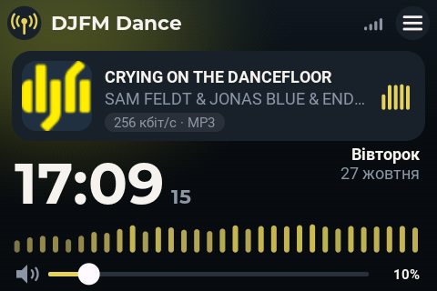
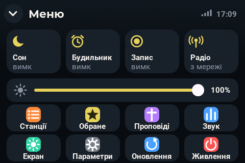
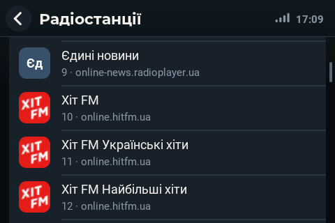
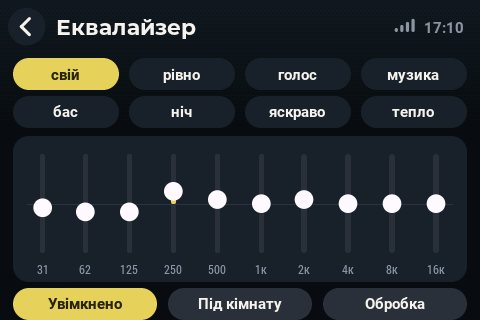
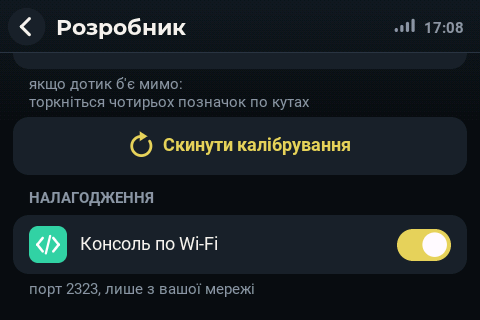

# ПОТУЖНЕ РАДІО — плата ES3C35P (3,5″)

**Українська** · [English](README.en.md)

> Інша плата — **[ПОТУЖНЕ РАДІО для ES3C28P (2,8″)](https://github.com/roman885-85/potuzhne-radio)**: основний
> проєкт, з якого це радіо перенесено. Там же — докладний опис усіх екранів, сторінки радіо в браузері й програм.

Інтернет-радіо на платі **LCDwiki ES3C35P**: ESP32-S3 (16 МБ флеш, 8 МБ PSRAM), екран **3,5″ IPS 320×480**
на контролері ST77922 (QSPI) з **вбудованим сенсором**, кодек ES8311 з мікрофоном і підсилювачем SC8002B,
слот microSD (SDIO), світлодіод WS2812. Радіо працює в ландшафті **480×320** (роз'єм USB праворуч).

Те саме ПОТУЖНЕ РАДІО, що й на ES3C28P, — радіостанції з інтернету, музика з картки, проповіді з сайту церкви,
будильник, запис ефіру, бездротова колонка AirPlay і DLNA, сторінка в браузері й програми для Android, Windows і
Mac, — перенесене на більший екран і новий контролер. Щоб працювати над ним без кабелю, радіо має **консоль
налагодження по Wi-Fi**: команди, журнал, знімки екрана й прошивка — по мережі.

<p>


</p>
<p>


</p>

> **Стан:** версія **1.0** — перевірка на платі. Випусків для цієї плати ще немає: вони з'являться тут, щойно все
> перевірено, і тоді радіо оновлюватиметься саме. До того — прошивка зі зібраного коду (див. «Збирання»).

---

## Зміст

- [Що вміє](#що-вміє)
- [Чим відрізняється від ES3C28P](#чим-відрізняється-від-es3c28p)
- [Плата й виводи](#плата-й-виводи) · [Зовнішній ЦАП PCM5100/PCM5102A](#зовнішній-цап-pcm5100pcm5102a)
- [Встановлення](#встановлення)
- [Робота без USB: консоль, знімки екрана й прошивка по Wi-Fi](#робота-без-usb-консоль-знімки-екрана-й-прошивка-по-wi-fi)
- [Збирання з вихідного коду](#збирання-з-вихідного-коду)
- [Що де лежить](#що-де-лежить)
- [Ліцензія й подяки](#ліцензія-й-подяки)

---

## Що вміє

- **Радіостанції з інтернету** — MP3, AAC, FLAC, WAV; плавні перемикання, назви пісень, логотипи станцій. Радіо
  знаходить їх саме — у каталозі radio-browser, на сайті станції, у службі Google — і кожен перевіряє, чи його можна
  прочитати в клітинці 45×45: дрібний напис чи білий знак на білому відкидається, пошук іде далі.
- **Картка пам'яті** — музика й записи ефіру; записи пультів Behringer X-LIVE (WAV до 32 каналів × 32 біти)
  грають зведеними.
- **Проповіді** з сайту церкви — архів, обкладинки, перемотка, повернення до станції.
- **Будильник** (будить і вимкнене радіо) і **таймер сну** з плавним затуханням; **літній і зимовий час** — сам.
- **Запис ефіру** на картку.
- **Звук:** еквалайзер на 10 смуг із пресетами, захист динаміка, віртуальний бас, тонкомпенсація, баланс,
  поправка під кімнату вбудованим мікрофоном (і з зовнішнім ЦАП — тони йдуть у колонки з гучністю музики, поправка
  діє на тому виході, де її зміряли); максимальна гучність у відсотках від повної (Звук › Обробка) — гучність
  на 100 % дає саме стільки, зручно з голосним зовнішнім підсилювачем; «Низ: м'який» — без гуркоту й рипіння
  (сумарний підйом низу до +10 дБ, зріз інфразвуку на лінійному виході, м'якша поправка під кімнату на низах),
  «як був» — попередня обробка.
- **Мікрофон:** хлопки й стук по корпусу як команди, присутність у кімнаті.
- **Бездротова колонка:** AirPlay (iPhone, iPad, Mac) — звук іде за мітками часу телефона, тож у відео збігається з
  картинкою, — і DLNA.
- **Автостарт:** увімкнули живленням чи збудили дотиком — грає остання станція; обірвався потік — радіо саме
  з'єднується знову (кілька спроб за хвилину).
- **Сторінка радіо в браузері** (`http://potuzhne-xxxx.local/`) і програми для Android, Windows, Mac — ті самі,
  що й для ES3C28P.
- **Інтерфейс** із плавними анімаціями: сторінки в'їжджають зсувом, списки гортаються з інерцією, повзунок
  гучності доїжджає плавно. Кадр складається в PSRAM і йде на панель цілим за сигналом розгортки (TE) — без
  розривів. Кожна сторінка налаштувань уміщається на один екран (Параметри й Розробник — сіткою розділів);
  гортаються лише списки — станції, проповіді, мережі.
- **Мови екрана:** українська й англійська.
- **Консоль налагодження по Wi-Fi** — див. [нижче](#робота-без-usb-консоль-знімки-екрана-й-прошивка-по-wi-fi).

Докладно про кожен екран і сторінку радіо — в описі основного проєкту:
[github.com/roman885-85/potuzhne-radio](https://github.com/roman885-85/potuzhne-radio#екран-радіо).

---

## Чим відрізняється від ES3C28P

| | ES3C28P | **ES3C35P** |
|---|---|---|
| Екран | 2,8″ 240×320, ILI9341V (SPI) | **3,5″ 320×480, ST77922 (QSPI, 80 МГц)**; радіо — у ландшафті 480×320 |
| Поворот | апаратний | у режимі QSPI панель не повертає — радіо повертає кадр саме (векторні інструкції ESP32-S3) |
| Сенсор | FT6336 | **вбудований у ST77922** (I2C 0x55) |
| Підсилювач | FM8002E | SC8002B (вмикається низьким рівнем на GPIO1) |
| Інтерфейс | 320×240 | той самий, збільшений ×4/3: шрифти, кнопки, відступи |
| Зовнішній ЦАП | на вільні виводи | на штатні роз'єми P2/P3, без паяння (див. нижче) |
| Випуски | [potuzhne-radio](https://github.com/roman885-85/potuzhne-radio/releases) | цей репозиторій (ще не було) |

Обидві плати збираються з однієї вихідної теки (`source/yoRadio/myoptions.h`); яку саме — каже
`firmware/rebuild.sh`.

---

## Плата й виводи

ESP32-S3 N16R8: 16 МБ QSPI-флеш, 8 МБ OPI PSRAM; USB-CDC прямо в ESP32-S3, без мікросхеми USB-UART.

| Вузол | Виводи |
|---|---|
| Екран ST77922, QSPI | SCK 12, D0 11, D1 13, D2 14, D3 9, CS 10, TE 42; підсвітка 41 (ШІМ) |
| Сенсор (у ST77922) | I2C SDA 38, SCL 39, адреса 0x55; INT 47, RST 48 |
| Кодек ES8311 | I2C 38/39 (0x18); I2S MCLK 17, BCLK 18, LRCK 21, DOUT 15, DIN 16 (мікрофон) |
| Підсилювач SC8002B | вмикання — GPIO1 низьким рівнем |
| microSD | SDIO 4 біти: CLK 5, CMD 4, D0 6, D1 7, D2 2, D3 3 |
| Світлодіод WS2812 | 40 |
| Напруга акумулятора | 8 (дільник 100 К / 100 К) |
| MUTE зовнішнього підсилювача | RXD0 (IO44), роз'єм P2, контакт 4 |

Кнопки в роботі радіо не беруть участі — лише сенсор; BOOT потрібна тільки для прошивки.
Сторінка плати виробника: <https://www.lcdwiki.com/3.5inch_ESP32-S3_Display>.

### Зовнішній ЦАП PCM5100/PCM5102A

Для лінійного виходу на підсилювач чи навушники — модуль PCM5100/PCM5102A на штатних роз'ємах плати
(4 контакти, крок 1,25 мм), без паяння:

| Модуль | Плата |
|---|---|
| BCK | P3, контакт 4 — IO45 |
| LCK | P3, контакт 3 — IO46 |
| DIN | P2, контакт 3 — TXD0 (IO43) |
| VIN | P2, контакт 1 — +5 В |
| GND | P2 чи P3, контакт 2 |
| SCK | на GND (модуль сам робить такт) |
| XSMT | на 3,3 В (P3, контакт 1) |

Далі на екрані: **Меню › Параметри › Розробник › Аудіовихід** — «стерео ЦАП, лінійний вихід».

### MUTE зовнішнього підсилювача

Радіо глушить зовнішній підсилювач (чи ЦАП через його вхід XSMT) завжди, коли звуку немає: на старті — аж до
першого звуку, після зупинки, поки перемикається станція, з'єднується й набирає буфер, на гучності 0, уві сні, перед
перезапуском і оновленням. MUTE знімається лише тоді, коли звук справді йде на зовнішній ЦАП (станція, картка,
проповідь, AirPlay чи DLNA, звук події, тон перевірки), і вмикається знову через 0,3 с після останнього звуку.
Вивід — **RXD0 (IO44), роз'єм P2, контакт 4**. Налаштування: **Меню › Параметри › Розробник › MUTE підсилювача
(RXD0)** (і на сторінці радіо: Розробник):

| Режим | Тихо — | Для чого | Резистор, щоб було тихо й на старті |
|---|---|---|---|
| вимк | — | вивід не використовується | — |
| тихо — низьким | низький рівень | XSMT у PCM5102A, MUTE у PAM8403 | 10 кОм з RXD0 на GND |
| тихо — високим | високий рівень | MUTE у TPA3116 | 10 кОм з RXD0 на 3,3 В |

Поки прошивка не запустилась, RXD0 ніхто не веде (це вхід UART, і без резистора він читається як високий рівень) —
тишу на старті тримає саме резистор. Під
перемикачем видно, що на виводі зараз: «звук» чи «тихо». Для PCM5102A у режимі «тихо — низьким» XSMT іде на RXD0
(а не на 3,3 В) — так і показує схема підключення на екрані й на сторінці.

---

## Встановлення

### 1. Прошити (кабелем, перший раз)

Готовий образ — у [випусках](https://github.com/roman885-85/potuzhne-radio-es3c35p/releases/latest):
`PotuzhneRadio-ES3C35P-full.bin` записати з адреси 0x0, наприклад
`esptool.py --chip esp32s3 write_flash 0x0 PotuzhneRadio-ES3C35P-full.bin` (якщо після запису радіо не
запустилось — від'єднайте й під'єднайте живлення). Далі радіо оновлюється саме: **Меню › Оновлення**.

Або [зберіть](#збирання-з-вихідного-коду) самі й прошийте з теки `firmware`:

```bash
./flash.sh                 # повний образ: стирає станції, мережі й налаштування
./flash.sh --app-only      # лише програма: станції, мережі й налаштування лишаються
```

Плата сама входить у режим прошивки. Після запису вона лишається в завантажувачі — `flash.sh` перезапускає її
лінією RTS при опущеному DTR (піднятий DTR на цій платі тримає GPIO0 у нулі й знову відправляє в завантажувач).

### 2. Підключити до Wi-Fi

Поки мережі немає, радіо показує список мереж: виберіть свою й наберіть пароль на екранній клавіатурі. Мережі —
лише 2,4 ГГц; радіо пам'ятає до п'яти.

### 3. Керувати

Дотиками на екрані, зі сторінки радіо в браузері (`http://potuzhne-xxxx.local/`; адреса — і на екрані «Про
радіо») або програмами — вони знаходять радіо в мережі самі.

---

## Робота без USB: консоль, знімки екрана й прошивка по Wi-Fi

Усе, що радіо пише в консоль (журнал `##…` і відповіді команд налагодження), іде ще й у мережу — на порт
**TCP 2323**. Під'єднаний клієнт бачить журнал наживо й надсилає ті самі команди, що й по USB. Кабель потрібен
лише для першої прошивки.

- **Увімкнено типово.** Вимикач — **Меню › Параметри › Розробник › Налагодження › Консоль по Wi-Fi**; під ним
  видно, хто під'єднаний.

  

- **Лише зі своєї мережі:** радіо приймає з'єднання тільки з тієї ж підмережі, що й саме.
- **Журнал у пам'яті:** останні 64 КБ виводу (зокрема старт, якого по мережі ще не було чути) радіо тримає в
  PSRAM; команда каналу `hist` віддає їх, `bye` — від'єднатись.
- Задачі радіо мережу не чекають ніколи: повільний клієнт лише пропускає частину журналу (з позначкою).

**Адреса радіо** — ім'я в мережі `potuzhne-xxxx.local` (видно на сторінці радіо) або IP. Інструменти беруть її з
`--net АДРЕСА`, зі змінної `RADIO_HOST` або з файла `tools/es3c35p/.radio` (перший рядок; у git не йде):

```bash
echo potuzhne-xxxx.local > tools/es3c35p/.radio
```

Немає USB-порту, а адреса є — інструменти самі йдуть по Wi-Fi.

| Що | Команда |
|---|---|
| Команди й відповіді | `tools/es3c35p/con.py --net info heap` |
| Слухати журнал | `tools/es3c35p/con.py --net --listen 60` |
| Журнал із пам'яті радіо | `tools/es3c35p/con.py --net hist` |
| Перезапуск і журнал старту | `tools/es3c35p/con.py --net --reset --listen 20` |
| Знімок екрана в PNG | `tools/es3c35p/scr.py --net знімок.png` |
| Прошивка без кабелю | `firmware/flash.sh --wifi` (або `--wifi АДРЕСА`) |
| Будь-яким клієнтом TCP | `nc potuzhne-xxxx.local 2323` |

**Прошивка по Wi-Fi:** `flash.sh --wifi` перевіряє, що файл зібрано саме для ES3C35P, надсилає його на `/update`,
чекає перезапуску й звіряє, що відповідає вже нова збірка. Радіо й саме перевіряє мітку плати в образі
(`POTUZHNE-RADIO-FW|ES3C35P|…`) і чужу прошивку не ставить — без кабелю її вже не було б чим виправити.

**Корисні команди консолі** (повний перелік — `source/yoRadio/src/menu/yoDebug.cpp`):

| Команда | Що робить |
|---|---|
| `info`, `heap`, `net` | стан: режим, станція, гучність; пам'ять; мережа |
| `play N`, `vol N`, `stop` | грати станцію N, гучність (0…254), зупинити |
| `aunet`, `audiostat` | посекундний звіт потоку; провали звуку за проміжок |
| `logost`, `logoqual`, `logoall` | логотипи: стан пошуку, чи читаються, знайти для всіх |
| `scr` | знімок екрана (його розбирає `scr.py`) |
| `netcon` | стан консолі по Wi-Fi: клієнт, надіслано, пропущено |
| `netfreeze N` | «завмерле» з'єднання станції — перевірка, як швидко радіо з'єднується наново |
| `reboot` | перезапуск |

---

## Збирання з вихідного коду

На Mac (на Linux — так само, крім `flash.sh`, який звертається до портів macOS):

1. [arduino-cli](https://arduino.github.io/arduino-cli/) і ядро ESP32 **3.3.3**:
   ```bash
   arduino-cli core update-index --additional-urls https://espressif.github.io/arduino-esp32/package_esp32_index.json
   arduino-cli core install esp32:esp32@3.3.3 --additional-urls https://espressif.github.io/arduino-esp32/package_esp32_index.json
   ```
2. Зібрати для ES3C35P (номер версії — у `firmware/VERSION`):
   ```bash
   cd firmware && ./rebuild.sh ES3C35P
   ```
   Перша збірка — близько 13 хвилин, наступні — кілька. Бібліотеки — у `build/sketchbook/libraries/`.
3. Готове — у `firmware/`: `PotuzhneRadio-ES3C35P-update.bin` (програма), `-full.bin` (повний образ),
   `web/` (файли сторінки радіо).
4. Прошити: `./flash.sh --app-only` (кабелем) або `./flash.sh --wifi` (по мережі).

`rebuild.sh` додає до збирання обгортку `dns_clear_cache` (`-Wl,--wrap`): у ядрі Arduino 3.3.3 перший запит
DNS після зміни адреси чистив кеш DNS без замка lwIP, і радіо падало (`Required to lock TCPIP core`).

Випуск на GitHub, звідки радіо оновлюються: `tools/release.sh <версія> <опис>` (`--beta` — попередній).

---

## Що де лежить

| Тека | Що там |
|---|---|
| `source/yoRadio/myoptions.h` | обидві плати: виводи, екран, звук; `PR_BOARD`, `PR_REPO` |
| `source/yoRadio/src/displays/displayST77922.*` | екран ST77922 по QSPI: кадр у PSRAM, вивід за TE, поворот кадру |
| `source/yoRadio/src/ST77922_Touch/` | сенсор, вбудований у ST77922 |
| `source/yoRadio/src/m2/` | інтерфейс на екрані: рушій, головний екран, меню, списки, оновлення |
| `source/yoRadio/src/extras/` | дописане: будильник і сон, звукова обробка, мікрофон, проповіді, запис, логотипи, веб-API, оновлення (`yoOta`), консоль по Wi-Fi (`yoNetCon`) |
| `source/yoRadio/src/audioI2S/` | декодер і потік (бібліотека Audio з правками: читання TLS, метадані, WAV до 32 каналів) |
| `source/yoRadio/web/` | сторінка радіо (`app.js`, `app.css`) |
| `firmware/` | `rebuild.sh` (збирання), `flash.sh` (прошивка кабелем і по Wi-Fi), `VERSION` |
| `tools/es3c35p/` | `con.py` (консоль по USB і Wi-Fi), `scr.py` (знімок екрана) |
| `tools/lang/en.json`, `tools/mklang.py` | англійський переклад екрана |
| `apps/` | програми-клієнти (Mac, Windows, Android) і збирачі |
| `media/es3c35p/` | знімки екрана для цього опису |

---

## Ліцензія й подяки

Прошивка заснована на [yoRadio](https://github.com/e2002/yoradio) (автор — e2002) і, як і вона, поширюється за
ліцензією **GNU GPL v3** — див. [LICENSE](LICENSE). Оригінальний опис yoRadio — у [source/README.md](source/README.md).

Приклади виробника плати — [LCDwiki](https://www.lcdwiki.com/3.5inch_ESP32-S3_Display); роботу з ST77922 і
сенсором звірено також із проєктом [xiaozhi-esp32](https://github.com/78/xiaozhi-esp32) (плата `lcdwiki-es3c35p`).

Шрифти інтерфейсу: **Roboto** і **Roboto Condensed** (Apache License 2.0), **Montserrat** і **Oswald** (SIL Open
Font License 1.1). Розпакування зображень — [stb_image](https://github.com/nothings/stb) (public domain / MIT).
